# zmk-config-moNa2

[sayu-hub/zmk-config-moNa2-v2](https://github.com/sayu-hub/zmk-config-moNa2-v2) をベースにした個人用 config。
キーマップは [zmk-config-Keyball44](https://github.com/bamebame/zmk-config-Keyball44) から移植している。

## キーマップ

`config/mona2.keymap` を変更すると `.github/workflows/draw.yml` が自動で描き直す。
表記の整え方は `keymap_drawer.config.yaml` の `raw_binding_map` を参照。



tap-dance キーは **上段がホールド時 / 下段が1タップ時**の動作。
図に出せない2タップ目の動作は `keymap_drawer.config.yaml` のコメントに記載。

# COROPITを使用するへ

COROPITを使用する方は以下のようにコードを編集してください。

mona2_r.overlay

修正前
```
  trackball_central: trackball_central@0 {
        status = "okay";
        compatible = "pixart,pmw3610";  //トラボセンサ用のドライバとバインド
        reg = <0>;
        spi-max-frequency = <2000000>;
        irq-gpios = <&gpio0 2 (GPIO_ACTIVE_LOW | GPIO_PULL_UP)>; //P0.02を指定(MOTION)
        cpi = <600>;
        //swap-xy;
        //invert-x; //COROPIT版ではコメントアウトを外す
        //invert-y; //COROPIT版ではコメントアウトを外す
        evt-type = <INPUT_EV_REL>;
        x-input-code = <INPUT_REL_X>;
        y-input-code = <INPUT_REL_Y>;
    };
};

```
**修正後**
```
  trackball_central: trackball_central@0 {
        status = "okay";
        compatible = "pixart,pmw3610";  //トラボセンサ用のドライバとバインド
        reg = <0>;
        spi-max-frequency = <2000000>;
        irq-gpios = <&gpio0 2 (GPIO_ACTIVE_LOW | GPIO_PULL_UP)>; //P0.02を指定(MOTION)
        cpi = <600>;
        //swap-xy;
        invert-x; //COROPIT版ではコメントアウトを外す
        invert-y; //COROPIT版ではコメントアウトを外す
        evt-type = <INPUT_EV_REL>;
        x-input-code = <INPUT_REL_X>;
        y-input-code = <INPUT_REL_Y>;
    };
};

```
